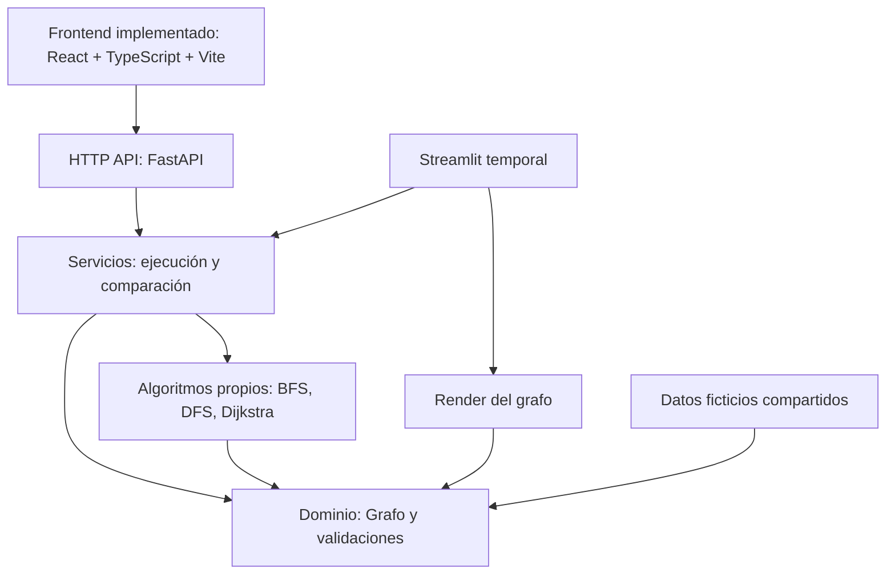

# Arquitectura de LogiExpress

**Estado:** núcleo Python, API FastAPI y frontend React + TypeScript + Vite están implementados e integrados mediante HTTP. Streamlit/Plotly se conserva como interfaz anterior. `feature/react-fastapi-integration` (`2bdd815`) es el candidato publicado y todavía no se fusionó en `main`.
**Fecha de actualización:** 2026-10-20.
**Audiencia:** estudiante desarrollador, OpenCode y evaluación académica.
**Documento complementario:** `CONTRACTS.md`.

## 1. Problema y objetivo del MVP

La empresa logística ficticia necesita representar una red de ubicaciones y conexiones con costos no negativos. El usuario escoge origen y destino; el sistema ejecuta BFS, DFS y Dijkstra, visualiza el grafo, diferencia **orden de visita** de **camino obtenido**, informa saltos y suma de pesos, y explica en qué sentido cada algoritmo resuelve (o no) un problema de minimización.

El MVP es una **demostración de estructuras de datos y algoritmos**, no un optimizador real de flotas o de entregas multidestino.

### Evidencia y alcance

- **Contexto académico informado:** grafos ponderados, BFS, DFS, Dijkstra, interacción y visualización.
- **Implementado:** núcleo Python con lista de adyacencia propia, servicios de rutas, API FastAPI y dashboard React servido por Vite; Streamlit continúa disponible y consume los mismos servicios.
- **Dirección implementada (ADR-015):** React + TypeScript + Vite → API HTTP FastAPI → servicios → algoritmos y dominio Python. El navegador solo presenta respuestas; BFS, DFS y Dijkstra permanecen en Python.
- **Fuera de alcance:** autenticación, microservicios, paquetes, centros de distribución complejos, multi-entrega, GPS, mapas reales, simulación de tráfico, base de datos y despliegue complejo.
- No se consultaron aquí fuentes primarias de rúbrica o tutoría; confirmar cuando se adjunten.

## 2. Diseño: monolito modular y dependencias hacia el núcleo

Se adopta un **monolito Python modular**. FastAPI y Streamlit utilizan los servicios Python; React se ejecuta como cliente web separado y obtiene el grafo y resultados por HTTP. El dominio y los algoritmos permanecen independientes y testables.



**Reglas de dependencia:** `domain` no importa los módulos externos; `algorithms` solo importa `domain` y `result`; `services` llama `algorithms` y `domain`; `api` valida y serializa HTTP y llama servicios; `ui` llama servicios y funciones visuales; `infrastructure` aporta datos ficticios compartidos. Ninguna interfaz ni endpoint reimplementa BFS, DFS o Dijkstra.

## 3. Estructura del repositorio integrado

> El árbol muestra la estructura integrada actual. Los commits de origen son `7fddb6e` (FastAPI) y `77f4050` (React); la rama de integración los conserva junto con sus adaptaciones HTTP.

```text
logiexpress/
├── AGENTS.md                       # Reglas generales de OpenCode (entregado)
├── opencode.json                   # Configuración inicial (entregado)
├── .opencode/
│   └── agents/
│       ├── architect.md           # Subagente de revisión (entregado)
│       └── algorithm-reviewer.md   # Subagente de revisión (entregado)
├── docs/                           # Especificaciones y guías (entregado)
│   ├── ARCHITECTURE.md
│   ├── REQUIREMENTS.md
│   ├── CONTRACTS.md
│   ├── DECISIONS.md
│   ├── IMPLEMENTATION_PLAN.md
│   └── OPENCODE_GUIDE.md
├── README.md                       # Instalación y uso de la aplicación integrada
├── pyproject.toml                  # Dependencias y herramientas
├── app.py                          # Punto de entrada Streamlit
├── frontend/                       # React + TypeScript + Vite
│   ├── package.json
│   ├── package-lock.json
│   ├── vite.config.ts               # Proxy HTTP hacia FastAPI
│   └── src/
│       ├── App.tsx
│       ├── services/api.ts          # Cliente HTTP
│       └── components/              # Controles, comparación y SVG
├── src/
│   └── logiexpress/
│       ├── __init__.py
│       ├── domain/
│       │   ├── __init__.py
│       │   ├── graph.py            # Grafo propio y lista de adyacencia
│       │   └── errors.py           # Errores de dominio si hacen falta
│       ├── algorithms/
│       │   ├── __init__.py
│       │   ├── result.py           # RouteResult
│       │   ├── bfs.py
│       │   ├── dfs.py
│       │   └── dijkstra.py
│       ├── services/
│       │   ├── __init__.py
│       │   └── route_service.py
│       ├── api/
│       │   ├── __init__.py
│       │   ├── main.py              # FastAPI app and HTTP routes
│       │   └── schemas.py           # Pydantic request/response contracts
│       ├── infrastructure/
│       │   ├── __init__.py
│       │   └── sample_data.py
│       └── ui/
│           ├── __init__.py
│           ├── dashboard.py
│           └── graph_view.py
└── tests/
    ├── test_graph.py
    ├── test_bfs.py
    ├── test_dfs.py
    ├── test_dijkstra.py
    ├── test_route_service.py
    └── test_api.py
```

`app.py` inicia la interfaz Streamlit anterior mediante `logiexpress.ui.dashboard`. React permanece en `frontend/`, separado del paquete Python.

## 4. Responsabilidad de cada módulo

| Módulo | Responsabilidad | No debe hacer |
|---|---|---|
| `domain/graph.py` | Añadir nodos/aristas, consultar vecinos y pesos, validar invariantes | Ejecutar algoritmos o mostrar elementos UI |
| `algorithms/bfs.py` | Camino mínimo por cantidad de aristas y orden de visita | Optimizar suma de pesos |
| `algorithms/dfs.py` | Recorrido y camino posible | Afirmar optimalidad |
| `algorithms/dijkstra.py` | Camino mínimo por suma de pesos no negativos | Aceptar pesos negativos |
| `algorithms/result.py` | Definir resultado común, sin formateo visual | Importar Streamlit |
| `services/route_service.py` | Elegir algoritmos, validar petición y reunir resultados | Reimplementar BFS/DFS/Dijkstra |
| `api/` | Validar HTTP, serializar resultados y delegar a los servicios | Reimplementar algoritmos o duplicar el grafo |
| `frontend/` | Consumir contratos HTTP, gestionar solicitudes y visualizar grafo/resultados | Calcular rutas o sustituir silenciosamente resultados con fixtures |
| `infrastructure/sample_data.py` | Crear un grafo ficticio reproducible | Manejar lógica de rutas |
| `ui/dashboard.py` | Streamlit anterior: recoger origen/destino y presentar resultados | Calcular rutas en callbacks |
| `ui/graph_view.py` | Dibujar ubicaciones, aristas, visitas y camino | Decidir cuál ruta es la óptima |

## 5. Modelo de datos

Representación central: **lista de adyacencia** `dict[str, dict[str, float]]`, p. ej.:

```python
{
    "A": {"B": 2.0, "C": 1.0},
    "B": {"A": 2.0, "C": 5.0, "D": 2.0, "E": 9.0},
    # ...
}
```

Las ubicaciones tienen identificadores de cadena no vacía; las aristas tienen pesos finitos `>= 0`. En el MVP una conexión es bidireccional. Los nombres amigables son etiquetas opcionales para mostrar en pantalla, sin afectar el cálculo. Se rechazan bucles y aristas duplicadas para simplificar la explicación; si la interfaz permite editar, las actualizaciones deben ser operaciones explícitas, no sobrescrituras silenciosas.

La unidad del peso se presenta como **costo abstracto**; solo usar `km` o minutos si el conjunto de datos realmente lo declara.

## 6. Algoritmos y resultados

Los tres reciben un `Graph`, un origen y un destino válidos, y producen `RouteResult` compatible. Consultar definiciones exactas en `CONTRACTS.md`.

| Algoritmo | Estructura que se debe demostrar | Garantía | Tiempo esperado |
|---|---|---|---|
| BFS | Cola FIFO, `deque` | Menor número de saltos | `O(V + E)` |
| DFS | Pila o recursión | Encuentra camino si existe; no optimiza | `O(V + E)` |
| Dijkstra | `heapq`, distancias, predecesores | Menor suma de pesos no negativos | `O((V+E) log V)` con heap |

La vista debe distinguir cuatro medidas: algoritmo, orden real de visita, camino reconstruido y suma de pesos de ese camino; indicar también cantidad de saltos. En los recorridos se puede detener la exploración al encontrar el destino, si se documenta esa decisión (esta es la convención inicial).

## 7. Ejemplo ficticio reproducible

Grafo propuesto (aristas **no dirigidas**):

| Origen | Destino | Peso |
|---|---|---:|
| A | B | 2 |
| A | C | 1 |
| B | C | 5 |
| B | D | 2 |
| B | E | 9 |
| C | D | 1 |
| D | E | 2 |

Para origen **A** y destino **E**, si se procesan vecinos en orden alfabético:

- **BFS:** camino `A → B → E` (2 saltos, costo total 11).
- **DFS recursivo en profundidad:** camino `A → B → C → D → E` (4 saltos, costo total 10).
- **Dijkstra:** camino `A → C → D → E` (3 saltos, costo total 4).

Estos resultados son **valores esperados de diseño**, no salidas ejecutadas del programa. Sirven como pruebas de aceptación y como demostración de por qué los algoritmos no son intercambiables.

## 8. Experiencia de usuario del MVP

El frontend React presenta controles de origen/destino, ejecución individual o comparación, grafo SVG dinámico y resultados recibidos de FastAPI. Streamlit permanece como interfaz anterior. Ambas distinguen el orden visitado del camino devuelto y muestran estados de error y ruta inexistente.

**Visualización implementada:** React dibuja el SVG con posiciones visuales calculadas en el frontend; Streamlit utiliza Plotly. Ninguna interfaz utiliza NetworkX para BFS, DFS o Dijkstra.

## 9. Pruebas y calidad

- Unitarias del dominio: nodos, aristas, simetría, duplicados, bucles, pesos negativos/no finitos y consultas a inexistentes.
- Unitarias de algoritmos: rutas, orden de visita, costo, desconexión, ciclos, cero, empates, mismo origen/destino.
- Servicio: solicitud inválida, elección de algoritmo y coherencia de `RouteResult`.
- Pruebas de interfaz: manuales o automáticas proporcionales al MVP.
- **Verificación ejecutada en Python 3.13.5:** 130 pruebas pytest, `ruff check .`, `pip check`, formato dirigido de los archivos nuevos y un smoke HTTP de Streamlit. `ruff format --check .` conserva cinco hallazgos ya presentes en `main`: `docs/CONTRACTS.md` y cuatro pruebas existentes; Python 3.10 aún no se ha probado.
- **Frontend/integración:** 15 pruebas Vitest, TypeScript, build de producción y prueba responsive Chromium. Las revisiones RDD anteriores quedaron incompletas y no son aprobaciones.

## 10. Evolución controlada

1. Contratos y estructura mínima → dominio del grafo + pruebas.
2. BFS, DFS, Dijkstra propios + pruebas + resultados de ejemplo.
3. Servicio + dashboard Streamlit de visualización + comprobación manual.
4. API FastAPI sobre los servicios existentes, con contratos y pruebas; implementada en `feature/fastapi-foundation` (`7fddb6e`).
5. Frontend React + TypeScript + Vite conectado por HTTP; implementado en `feature/react-frontend` (`77f4050`) e integrado en `feature/react-fastapi-integration` (`2bdd815`).
6. La rama integrada está publicada y pendiente de revisión/merge a `main`; no se ha ejecutado el merge. Las revisiones RDD anteriores siguen incompletas.
7. Persistencia u otras ampliaciones **solo** con valor demostrado y aprobación.

Para el orden y las condiciones de cierre de cada etapa, consultar `IMPLEMENTATION_PLAN.md`.
