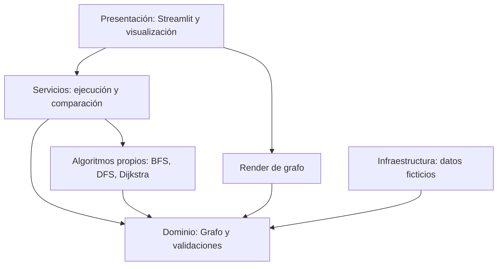

# Arquitectura propuesta — LogiExpress

**Estado:** propuesta inicial con núcleo, servicios y dashboard implementados progresivamente; consultar `CHANGELOG.md` y las verificaciones de cada incremento.
**Fecha de preparación:** 2026-10-19.
**Audiencia:** estudiante desarrollador, OpenCode y evaluación académica.
**Documento complementario:** `CONTRACTS.md`.

## 1. Problema y objetivo del MVP

La empresa logística ficticia necesita representar una red de ubicaciones y conexiones con costos no negativos. El usuario escoge origen y destino; el sistema ejecuta BFS, DFS y Dijkstra, visualiza el grafo, diferencia **orden de visita** de **camino obtenido**, informa saltos y suma de pesos, y explica en qué sentido cada algoritmo resuelve (o no) un problema de minimización.

El MVP es una **demostración de estructuras de datos y algoritmos**, no un optimizador real de flotas o de entregas multidestino.

### Evidencia y alcance

- **Contexto académico informado:** grafos ponderados, BFS, DFS, Dijkstra, interacción y visualización.
- **Decisión inicial propuesta:** Python + Streamlit + núcleo propio con listas de adyacencia; grafo no dirigido y pesos no negativos.
- **Fuera del MVP salvo nueva evidencia/decisión:** usuarios, autenticación, paquetes, centros de distribución complejos, multi-entrega, GPS, mapas reales, simulación de tráfico, FastAPI, React, base de datos obligatoria, despliegue complejo.
- No se consultaron aquí fuentes primarias de rúbrica o tutoría; confirmar cuando se adjunten.

## 2. Diseño: monolito modular y dependencias hacia el núcleo

Se adopta un **monolito Python modular**. Un solo proceso ejecuta Streamlit; el dominio y los algoritmos permanecen independientes y testables.



**Reglas de dependencia:** `domain` no importa ninguno de los otros módulos; `algorithms` solo importa `domain` y `result` (contrato neutro); `services` llama `algorithms` y `domain`; `ui` llama servicios y funciones visuales; `infrastructure` aporta datos de demostración, sin filtrar detalles a los algoritmos.

## 3. Estructura prevista del repositorio

> Este árbol describe **archivos a crear progresivamente por OpenCode**; no afirma que ya estén implementados. El paquete documental inicial sí contiene `AGENTS.md`, `opencode.json`, `.opencode/agents` y `docs/`.

```text
logiexpress/
├── AGENTS.md                       # Reglas generales de OpenCode (entregado)
├── opencode.json                   # Configuración inicial (entregado)
├── .opencode/
│   └── agents/
│       ├── architect.md           # Subagente de revisión (entregado)
│       └── algorithm-reviewer.md   # Subagente de revisión (entregado)
├── docs/                           # Especificaciones y guías (entregado)
│   ├── ARCHITECTURE.md
│   ├── REQUIREMENTS.md
│   ├── CONTRACTS.md
│   ├── DECISIONS.md
│   ├── IMPLEMENTATION_PLAN.md
│   └── OPENCODE_GUIDE.md
├── README.md                       # Introducción al kit (entregado; actualizar al implementar)
├── pyproject.toml                  # [FUTURO] Dependencias y herramientas
├── uv.lock                         # [FUTURO] Generado por uv
├── app.py                          # [FUTURO] Punto de entrada Streamlit
├── src/
│   └── logiexpress/
│       ├── __init__.py
│       ├── domain/
│       │   ├── __init__.py
│       │   ├── graph.py            # Grafo propio y lista de adyacencia
│       │   └── errors.py           # Errores de dominio si hacen falta
│       ├── algorithms/
│       │   ├── __init__.py
│       │   ├── result.py           # RouteResult
│       │   ├── bfs.py
│       │   ├── dfs.py
│       │   └── dijkstra.py
│       ├── services/
│       │   ├── __init__.py
│       │   └── route_service.py
│       ├── infrastructure/
│       │   ├── __init__.py
│       │   └── sample_data.py
│       └── ui/
│           ├── __init__.py
│           ├── dashboard.py
│           └── graph_view.py
└── tests/
    ├── test_graph.py
    ├── test_bfs.py
    ├── test_dfs.py
    ├── test_dijkstra.py
    └── test_route_service.py
```

`app.py` puede limitarse a importar y ejecutar una función `main()` en `logiexpress.ui.dashboard`. Evita módulos o directorios vacíos si un incremento todavía no los necesita.

## 4. Responsabilidad de cada módulo

| Módulo | Responsabilidad | No debe hacer |
|---|---|---|
| `domain/graph.py` | Añadir nodos/aristas, consultar vecinos y pesos, validar invariantes | Ejecutar algoritmos o mostrar elementos UI |
| `algorithms/bfs.py` | Camino mínimo por cantidad de aristas y orden de visita | Optimizar suma de pesos |
| `algorithms/dfs.py` | Recorrido y camino posible | Afirmar optimalidad |
| `algorithms/dijkstra.py` | Camino mínimo por suma de pesos no negativos | Aceptar pesos negativos |
| `algorithms/result.py` | Definir resultado común, sin formateo visual | Importar Streamlit |
| `services/route_service.py` | Elegir algoritmos, validar petición y reunir resultados | Reimplementar BFS/DFS/Dijkstra |
| `infrastructure/sample_data.py` | Crear un grafo ficticio reproducible | Manejar lógica de rutas |
| `ui/dashboard.py` | Recoger origen/destino y presentar resultados | Calcular rutas en callbacks |
| `ui/graph_view.py` | Dibujar ubicaciones, aristas, visitas y camino | Decidir cuál ruta es la óptima |

## 5. Modelo de datos

Representación central: **lista de adyacencia** `dict[str, dict[str, float]]`, p. ej.:

```python
{
    "A": {"B": 2.0, "C": 1.0},
    "B": {"A": 2.0, "C": 5.0, "D": 2.0, "E": 9.0},
    # ...
}
```

Las ubicaciones tienen identificadores de cadena no vacía; las aristas tienen pesos finitos `>= 0`. En el MVP una conexión es bidireccional. Los nombres amigables son etiquetas opcionales para mostrar en pantalla, sin afectar el cálculo. Se rechazan bucles y aristas duplicadas para simplificar la explicación; si la interfaz permite editar, las actualizaciones deben ser operaciones explícitas, no sobrescrituras silenciosas.

La unidad del peso se presenta como **costo abstracto**; solo usar `km` o minutos si el conjunto de datos realmente lo declara.

## 6. Algoritmos y resultados

Los tres reciben un `Graph`, un origen y un destino válidos, y producen `RouteResult` compatible. Consultar definiciones exactas en `CONTRACTS.md`.

| Algoritmo | Estructura que se debe demostrar | Garantía | Tiempo esperado |
|---|---|---|---|
| BFS | Cola FIFO, `deque` | Menor número de saltos | `O(V + E)` |
| DFS | Pila o recursión | Encuentra camino si existe; no optimiza | `O(V + E)` |
| Dijkstra | `heapq`, distancias, predecesores | Menor suma de pesos no negativos | `O((V+E) log V)` con heap |

La vista debe distinguir cuatro medidas: algoritmo, orden real de visita, camino reconstruido y suma de pesos de ese camino; indicar también cantidad de saltos. En los recorridos se puede detener la exploración al encontrar el destino, si se documenta esa decisión (esta es la convención inicial).

## 7. Ejemplo ficticio reproducible

Grafo propuesto (aristas **no dirigidas**):

| Origen | Destino | Peso |
|---|---|---:|
| A | B | 2 |
| A | C | 1 |
| B | C | 5 |
| B | D | 2 |
| B | E | 9 |
| C | D | 1 |
| D | E | 2 |

Para origen **A** y destino **E**, si se procesan vecinos en orden alfabético:

- **BFS:** camino `A → B → E` (2 saltos, costo total 11).
- **DFS recursivo en profundidad:** camino `A → B → C → D → E` (4 saltos, costo total 10).
- **Dijkstra:** camino `A → C → D → E` (3 saltos, costo total 4).

Estos resultados son **valores esperados de diseño**, no salidas ejecutadas del programa. Sirven como pruebas de aceptación y como demostración de por qué los algoritmos no son intercambiables.

## 8. Experiencia de usuario del MVP

Una sola pantalla Streamlit es suficiente: selector de origen, selector de destino, botón de ejecución, visualización del grafo y tabla comparativa con recorridos/rutas/costos. Se puede resaltar con color el camino encontrado y enumerar el orden de visita. Mostrar mensajes distintos para `origen=destino`, `destino inalcanzable` y `nodo inválido`.

**Visualización propuesta:** Graphviz o Plotly. Elegir una sola alternativa antes de implementarla, con criterios de simplicidad, claridad y compatibilidad con Streamlit. El uso de NetworkX solo para dibujar se podría aprobar de manera explícita; nunca usarlo como motor de BFS/DFS/Dijkstra.

## 9. Pruebas y calidad

- Unitarias del dominio: nodos, aristas, simetría, duplicados, bucles, pesos negativos/no finitos y consultas a inexistentes.
- Unitarias de algoritmos: rutas, orden de visita, costo, desconexión, ciclos, cero, empates, mismo origen/destino.
- Servicio: solicitud inválida, elección de algoritmo y coherencia de `RouteResult`.
- Pruebas de interfaz: manuales o automáticas proporcionales al MVP.
- **Comandos previstos una vez exista el proyecto Python y estén instaladas las herramientas:** `uv run pytest`, `uv run ruff check .` y `uv run streamlit run app.py`. Su presencia en este documento no acredita ejecución.

## 10. Evolución controlada

1. Contratos y estructura mínima → dominio del grafo + pruebas.
2. BFS, DFS, Dijkstra propios + pruebas + resultados de ejemplo.
3. Servicio + interfaz de visualización + comprobación manual.
4. Documentación de diseño y decisiones, evidencia de pruebas y defensa académica.
5. Persistencia u otras ampliaciones **solo** con valor demostrado y aprobación.

Para el orden y las condiciones de cierre de cada etapa, consultar `IMPLEMENTATION_PLAN.md`.
