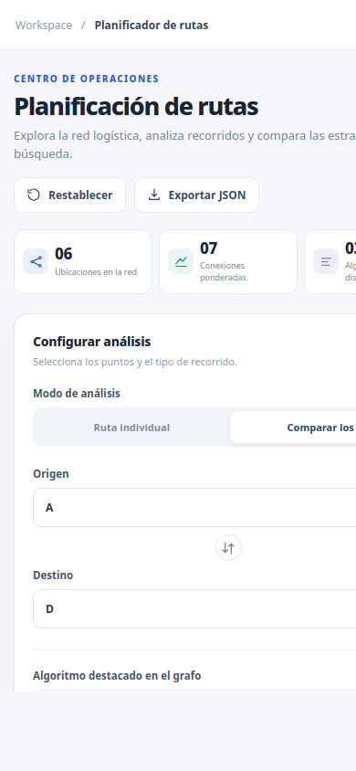
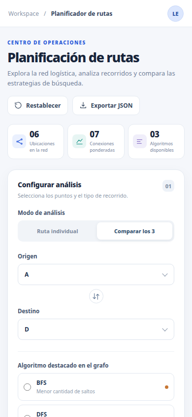

# Validación responsive de React + FastAPI

La captura muestra un **mapa esquemático**, no una cartografía geográfica. Las ubicaciones, conexiones y pesos corresponden a un escenario **ficticio**; sus pesos son **costos abstractos** y no distancias ni tiempos reales. Las comprobaciones validan la presentación y correspondencia con la API, no la realidad de una red logística.

## Causa de la captura recortada

La captura inicial no representaba un viewport CSS de 390 × 844. En este entorno, `--window-size=390,844` fijó el tamaño exterior/captura de Chromium, pero no emuló esas dimensiones CSS: el target de DevTools reportó un viewport mayor y la imagen de 390 px recortó su contenido. El layout no tenía desbordamiento horizontal en un viewport móvil real. No se añadió `overflow-x: hidden` ni se alteró el CSS para ocultar el síntoma.

La comprobación automatizada usa `Emulation.setDeviceMetricsOverride`, exige que `window.innerWidth` y `window.innerHeight` coincidan con cada dimensión pedida, y verifica scroll width, contenido recortado, controles y resultados. En cada tamaño ejecuta el análisis mediante la API y compara el camino, costo y saltos renderizados con una respuesta nueva de Python; también comprueba que el SVG resalte sus aristas.

## Evidencia visual móvil

La imagen anterior conserva la captura generada con el tamaño exterior no emulado. La posterior es Chromium con viewport CSS emulado correctamente. La diferencia documenta y corrige el método de captura; no representa un cambio de CSS.

| Captura anterior: `--window-size` | Captura validada: viewport CSS 390 × 844 |
|---|---|
|  |  |

## Reproducir la verificación

Desde la raíz, iniciar FastAPI:

```bash
python -m uvicorn logiexpress.api.main:app --reload --host 127.0.0.1 --port 8000
```

En otra terminal, iniciar Vite desde `frontend/`:

```bash
LOGIEXPRESS_API_TARGET=http://127.0.0.1:8000 npm run dev -- --host 127.0.0.1 --port 5173
```

En una tercera terminal, ejecutar desde `frontend/`:

```bash
CHROME_BIN=/snap/bin/chromium \
LOGIEXPRESS_TEST_URL=http://127.0.0.1:5173/ \
RESPONSIVE_SCREENSHOT_DIR=/tmp/opencode/logiexpress-responsive \
npm run test:responsive
```

La prueba cubre **390 × 844, 375 × 812, 768 × 1024, 1366 × 768 y 1440 × 900**. También valida la carga del grafo de FastAPI y que la ruta y métricas visibles correspondan al endpoint Python. El smoke incluye respuestas 404/422; los tests React cubren fallos de conexión y respuestas obsoletas.

## Limitaciones registradas

- La revisión RDD anterior sigue incompleta por la indisponibilidad de `external.select_intended_untracked`; no se presenta como aprobación.
- La validación de Python 3.10 sigue pendiente; esta ejecución usa Python 3.13.5.
- `ruff format --check .` señala cinco hallazgos que también aparecen en `main`; no se modificaron esos archivos preexistentes.
